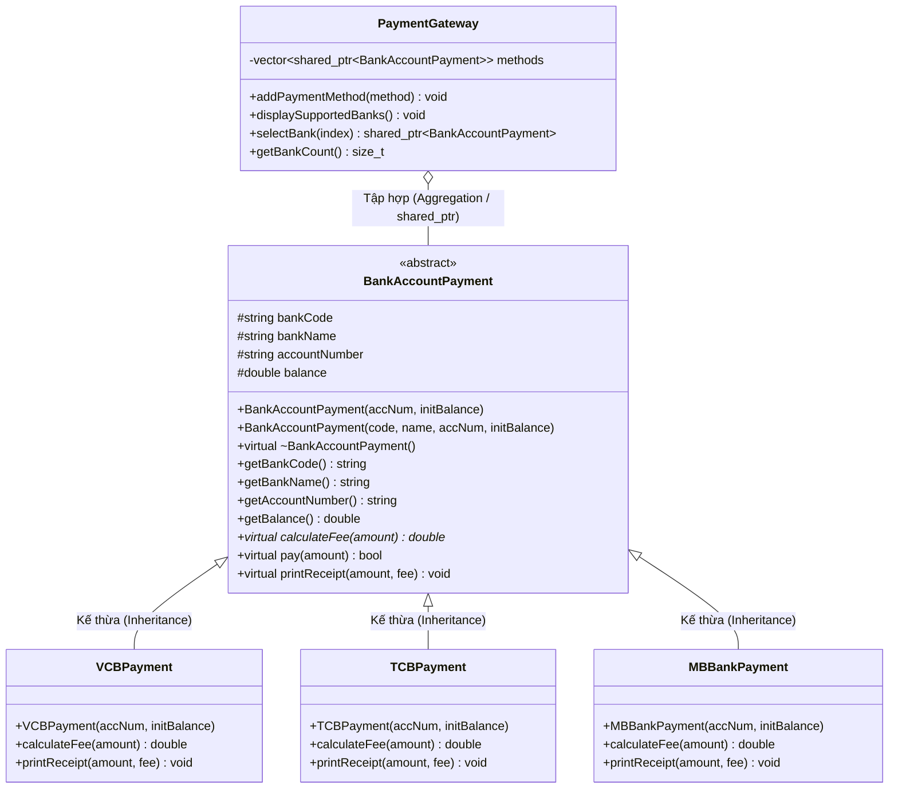

# Hệ Thống Thanh Toán Ngân Hàng Qua Terminal (Terminal Banking Payment System)

Dự án mô phỏng hệ thống cổng thanh toán ngân hàng (Payment Gateway) qua giao diện Terminal viết bằng C++, tuân thủ chặt chẽ các nguyên lý lập trình hướng đối tượng (OOP) và nguyên lý **Open/Closed Principle (OCP)** trong SOLID.

---

## 1. Tổng Quan Kiến Trúc & Thiết Kế OOP

Hệ thống được thiết kế theo mô hình kiến trúc phân lớp hướng đối tượng với các vai trò rõ ràng:



---

## 2. Minh Chứng Nguyên Lý OCP (Open/Closed Principle)

### Nguyên lý Open/Closed (Mở để mở rộng, Đóng để sửa đổi):
> *"Software entities (classes, modules, functions, etc.) should be open for extension, but closed for modification."*

### Trong hệ thống này:
1. **Closed for Modification (Đóng với việc sửa đổi):**
   - Khi cần tích hợp ngân hàng mới (ví dụ: `MBBankPayment` thu phí 0.2%), ta **không cần chỉnh sửa bất kỳ dòng mã nào** trong:
     - Lớp cơ sở trừu tượng `BankAccountPayment`
     - Các lớp ngân hàng đã có: `VCBPayment`, `TCBPayment`
     - Lớp điều phối trung tâm: `PaymentGateway`
   - Cổng thanh toán `PaymentGateway` không sử dụng câu lệnh `switch-case` hay `if-else if` để kiểm tra mã ngân hàng. Thay vào đó, nó giao tiếp hoàn toàn thông qua con trỏ đa hình `std::shared_ptr<BankAccountPayment>`.

2. **Open for Extension (Mở cho việc mở rộng):**
   - Ta chỉ cần tạo một lớp mới `MBBankPayment` kế thừa từ `BankAccountPayment` và cài đặt (override) phương thức tính phí `calculateFee(double amount) const`:
     ```cpp
     double MBBankPayment::calculateFee(double amount) const {
         return amount * 0.002; // 0.2%
     }
     ```
   - Tại `main()`, chỉ cần nạp đối tượng vào hệ thống:
     ```cpp
     gateway.addPaymentMethod(std::make_shared<MBBankPayment>("0987654321", 1000000.0));
     ```
   - Mọi luồng tính toán phí, kiểm tra số dư và in biên lai tự động hoạt động chính xác thông qua cơ chế Late Binding (Đa hình lúc chạy).

---

## 3. Cấu Trúc Thư Mục Dự Án

```
OOP/
├── include/
│   ├── BankAccountPayment.h  # Định nghĩa lớp cơ sở trừu tượng
│   ├── VCBPayment.h          # Lớp ngân hàng Vietcombank (phí cố định 1,100 VND)
│   ├── TCBPayment.h          # Lớp ngân hàng Techcombank (miễn phí 0 VND)
│   ├── MBBankPayment.h       # Lớp ngân hàng MBBank (phí 0.2% - minh chứng OCP)
│   ├── PaymentGateway.h      # Lớp điều phối cổng thanh toán
│   └── Utils.h               # Hàm tiện ích định dạng tiền tệ và xử lý nhập liệu
├── src/
│   ├── BankAccountPayment.cpp
│   ├── VCBPayment.cpp
│   ├── TCBPayment.cpp
│   ├── MBBankPayment.cpp
│   ├── PaymentGateway.cpp
│   ├── Utils.cpp
│   └── main.cpp              # Điểm khởi chạy chương trình & giao diện Terminal
├── CMakeLists.txt            # File cấu hình build CMake
├── Makefile                  # File cấu hình Make
├── .gitignore                # Bỏ qua các file nhị phân khi commit Git
└── README.md                 # Tài liệu chi tiết dự án
```

---

## 4. Hướng Dẫn Biên Dịch & Chạy Chương Trình

### Cách 1: Sử dụng g++ trực tiếp (Khuyên dùng)
```bash
# Biên dịch toàn bộ mã nguồn C++17
g++ -std=c++17 -Wall -Wextra -Iinclude src/*.cpp -o payment_system.exe

# Chạy chương trình
./payment_system.exe
```

### Cách 2: Sử dụng CMake
```bash
mkdir build
cd build
cmake ..
cmake --build .
./payment_system.exe
```

### Cách 3: Sử dụng Makefile
```bash
make
./payment_system.exe
```

---

## 5. Kịch Bản Kiểm Thử (Test Cases)

| Kịch Bản | Ngân Hàng | Số Dư Ban Đầu | Số Tiền Chuyển | Phí Giao Dịch | Kết Quả Kỳ Vọng |
| :--- | :--- | :--- | :--- | :--- | :--- |
| **Case 1: VCB** | Vietcombank | 500,000 VND | 100,000 VND | 1,100 VND (cố định) | Thành công. Trừ 101,100 VND. Số dư còn: 398,900 VND |
| **Case 2: TCB** | Techcombank | 200,000 VND | 50,000 VND | 0 VND (miễn phí) | Thành công. Trừ 50,000 VND. Số dư còn: 150,000 VND |
| **Case 3: MBB (OCP)** | MBBank | 1,000,000 VND | 200,000 VND | 400 VND (0.2%) | Thành công. Trừ 200,400 VND. Số dư còn: 799,600 VND |
| **Case 4: Thất bại** | Techcombank | 150,000 VND | 999,999,999 VND | 0 VND | Thất bại do số dư không đủ. Không trừ tiền. |
